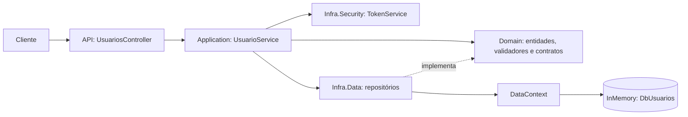
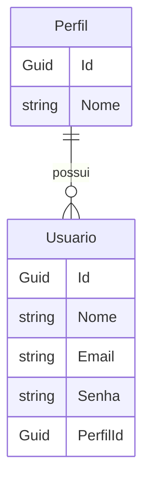

# Arquitetura

## Componentes

| Projeto | Responsabilidade |
| --- | --- |
| `UsuariosApp.Api` | Inicialização, injeção de dependências, Swagger/OpenAPI e `UsuariosController`. |
| `UsuariosApp.Application` | DTOs e orquestração dos casos de uso em `UsuarioService`. |
| `UsuariosApp.Domain` | Entidades, contratos dos repositórios e validadores. |
| `UsuariosApp.Infra.Data` | `DataContext` e implementações dos repositórios com EF Core InMemory. |
| `UsuariosApp.Infra.Security` | Geração de JWT em `TokenService`. |
| `UsuariosApp.Tests` | Testes unitários, doubles de repositórios e integração HTTP. |



As dependências de compilação são: API → Application, Domain, Infra.Data e Infra.Security; Application → Domain e Infra.Security; Infra.Data → Domain; Infra.Security → Domain. A API conecta contratos e implementações no contêiner de DI.

## Inicialização

`Program.cs` registra como scoped: `UsuarioService`, `TokenService`, `DataContext`, `IUsuarioRepository → UsuarioRepository` e `IPerfilRepository → PerfilRepository`. O pipeline habilita Swagger, chama `UseAuthorization()` e mapeia controllers. A presença de `UseAuthorization()` não configura validação de JWT.

O perfil local `http` executa em `http://localhost:5212`, no ambiente Development, com abertura do Swagger. Comando a partir da raiz da solução:

```powershell
dotnet run --project UsuariosApp.Api/UsuariosApp.Api.csproj --launch-profile http
```

## Fluxos

1. **Cadastro:** controller → serviço → `UsuarioValidation` → consulta de email → busca/criação do perfil → gravação do usuário → resposta 201. A consulta de email na validação usa `.Result`; as demais operações de repositório do serviço são aguardadas com `await`.
2. **Autenticação:** controller → serviço → repositório consulta email/senha e inclui perfil → `TokenService` gera JWT → resposta 200. Usuário ausente resulta em resposta 401.

## Modelo de dados



`DataContext` expõe `Usuarios` e `Perfis` e configura `UseInMemoryDatabase("DbUsuarios")`. Os repositórios adicionam entidades e chamam `SaveChangesAsync`. A consulta de autenticação usa `Include(u => u.Perfil)`.

`UsuarioMap` e `PerfilMap` declaram chaves, relacionamento, limites de tamanho e índices únicos. O contexto não implementa `OnModelCreating` para registrar esses mapas; o modelo atual utiliza convenções. O provedor InMemory também não oferece as garantias de um banco relacional. A verificação de email no serviço não constitui garantia de unicidade sob concorrência. Perfil e usuário são salvos em operações separadas.

## Configuração do token

`TokenService` recebe `IConfiguration` e lê `Jwt:Issuer`, `Jwt:Audience`, `Jwt:ExpirationInMinutes` e `Jwt:SecretKey`. O arquivo de configuração atual define emissor `UsuariosApp.Api`, audiência `PortalWeb` e duração de 60 minutos. A chave não é reproduzida nesta documentação.

O token contém `sub`, `email`, `ClaimTypes.NameIdentifier`, `ClaimTypes.Name` e `ClaimTypes.Role`, além de emissor, audiência e expiração. A aplicação gera tokens, mas não configura middleware para validá-los nas requisições.
